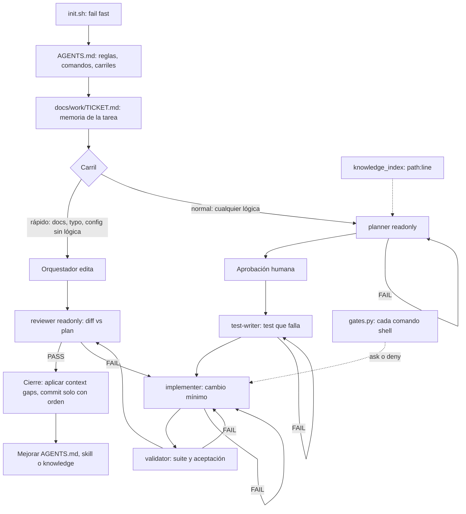
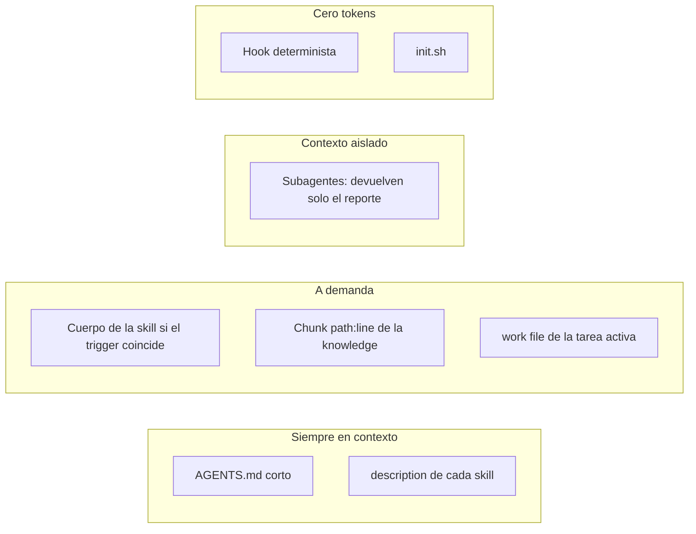

# why-harness

[English](README.md) | **Español**

> El modelo es el motor. El harness es el chasis, los frenos y el tablero.
> Este repo es un harness de IA genérico, y sobre todo, el **porqué** de cada pieza.

Un agente de código sin estructura lee de más, olvida lo que ya decidió, edita antes de entender y se autoaprueba. `why-harness` es una estructura mínima que se copia a cualquier proyecto para evitar eso: un pipeline de agentes con responsabilidades separadas, gates deterministas, memoria externa y una knowledge base que se consulta por fragmentos.

No depende de ningún dominio ni lenguaje. Los scripts usan solo la stdlib de Python y bash.

## Idea central

Hay dos tipos de archivos:

- **Invariantes**: los agentes, el hook, `init.sh` y el buscador. Se copian y no se editan.
- **Capas del proyecto**: lo único que cambia entre proyectos.

| Capa | Responde | Dónde |
|---|---|---|
| Reglas y comandos | ¿Qué está permitido y cómo se corre? | `AGENTS.md` |
| Cómo se escribe código aquí | ¿Qué patrón sigo? | `.cursor/skills/` |
| Qué es verdad en el dominio | ¿Qué significa esto y de dónde sale? | `docs/knowledge/` |

Cuando un agente falla por falta de contexto, su reporte dice en cuál de las tres capas estaba el hueco. Así el harness mejora con el uso (ver [feedback-loop](docs/concepts/feedback-loop.es.md)).

## Flujo



## Qué se carga y cuándo

El ahorro de tokens no sale de un truco, sale de decidir qué entra al contexto y cuándo.



Detalle en [token-economy](docs/concepts/token-economy.es.md).

## Estructura

```
why-harness/
├── AGENTS.md                 plantilla: bloques PROJECT marcados
├── .cursor/
│   ├── agents/               planner, test-writer, implementer, validator, reviewer
│   ├── hooks.json            beforeShellExecution -> gates.py
│   ├── hooks/gates.py        motor + tupla GATES (único bloque editable)
│   └── skills/
│       ├── adopt-harness/    instala este harness en un proyecto
│       └── example/          plantilla de skill, se reemplaza al instalar
├── scripts/
│   ├── init.sh               check de sesión (bloque PROJECT CONFIG arriba)
│   └── knowledge_index.py    búsqueda BM25 en memoria sobre docs/knowledge
├── tests/                    unittest de stdlib
└── docs/
    ├── README.md             índice: qué leer y cuándo
    ├── adopt.md              cómo instalarlo en un proyecto
    ├── references.md         fuentes de investigación detrás de cada decisión
    ├── concepts/             qué es cada pieza, por qué existe, cómo funciona
    ├── decisions/            ADRs: el porqué de cada decisión
    ├── knowledge/            formato de la knowledge base y ejemplos
    └── work/                 plantilla de la memoria de tarea
```

## Quickstart

```bash
./scripts/init.sh                                         # check de sesión
python3 -m unittest discover tests                        # tests del harness
python3 -m scripts.knowledge_index search "lifecycle" # buscar en la knowledge
```

Para instalarlo en un proyecto, o para empezar uno desde este repo: el skill `adopt-harness` en `.cursor/skills/adopt-harness/SKILL.md`, y la guía [docs/adopt.es.md](docs/adopt.es.md).

## Licencia

[MIT](LICENSE). Se puede forkear, copiar a otro proyecto y modificar. Conserva el aviso de copyright: la licencia exige que viaje con los archivos. El botón Fork de GitHub aparece cuando el repositorio es público.

## Referencias

Las decisiones salen de trabajo publicado. La lista, y qué aporta cada fuente, está en [docs/references.es.md](docs/references.es.md).

## Leer en este orden

1. [harness](docs/concepts/harness.es.md): qué es un harness y en qué se diferencia de un prompt.
2. [agents-and-subagents](docs/concepts/agents-and-subagents.es.md): el sentido de cada agente.
3. [pipeline-and-lanes](docs/concepts/pipeline-and-lanes.es.md): cómo fluye una tarea.
4. [token-economy](docs/concepts/token-economy.es.md): cómo se optimiza el contexto.
5. [decisions/](docs/decisions/0001-five-stage-pipeline-two-lanes.es.md): por qué es así y no de otra forma.

El archivo sin sufijo es la versión en inglés, y es la principal. Cada página enlaza su par en español arriba.
