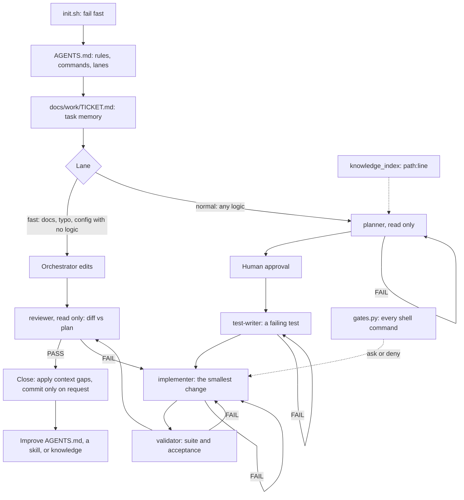
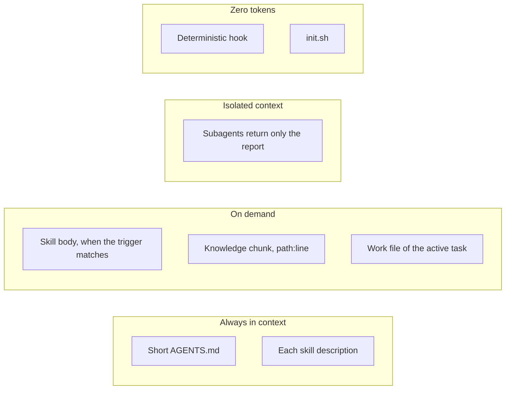

# why-harness

**English** | [Español](README.es.md)

> The model is the engine. The harness is the chassis, the brakes, and the dashboard.
> This repo is a generic AI harness, and above all the **why** behind every piece.

An unstructured coding agent reads too much, forgets what it already decided, edits before it understands, and approves its own work. `why-harness` is a minimal structure you copy into any project to prevent that: a pipeline of agents with separated responsibilities, deterministic gates, external memory, and a knowledge base queried by fragment.

It depends on no domain and no language. The scripts use only the Python standard library and bash.

## Core idea

Files fall into two kinds:

- **Invariants**: the agents, the hook, `init.sh`, and the search script. Copy them; do not edit them.
- **Project layers**: the only thing that changes between projects.

| Layer | It answers | Where |
|---|---|---|
| Rules and commands | What is allowed, and how do I run it? | `AGENTS.md` |
| How code is written here | Which pattern do I follow? | `.cursor/skills/` |
| What is true in the domain | What does this mean, and where does it come from? | `docs/knowledge/` |

When an agent fails for lack of context, its report names which of the three layers had the gap. That is how the harness improves with use (see [feedback-loop](docs/concepts/feedback-loop.md)).

## Flow



## What loads, and when

Token savings come from deciding what enters the context and when.



Detail in [token-economy](docs/concepts/token-economy.md).

## Layout

```
why-harness/
├── AGENTS.md                 template: marked PROJECT blocks
├── .cursor/
│   ├── agents/               planner, test-writer, implementer, validator, reviewer
│   ├── hooks.json            beforeShellExecution -> gates.py
│   ├── hooks/gates.py        engine + the GATES tuple (the only editable block)
│   └── skills/example/       skill template
├── scripts/
│   ├── init.sh               session check (PROJECT CONFIG block at the top)
│   └── knowledge_index.py    in-memory BM25 search over docs/knowledge
├── tests/                    stdlib unittest
└── docs/
    ├── README.md             index: what to read, and when
    ├── adopt.md              how to install it in a project
    ├── concepts/             what each piece is, why it exists, how it works
    ├── decisions/            ADRs: why each decision was made
    ├── knowledge/            knowledge base format and examples
    └── work/                 task memory template
```

## Quickstart

```bash
./scripts/init.sh                                  # session check
python3 -m unittest discover tests                 # harness tests
python3 -m scripts.knowledge_index search "ciclo de vida"  # the sample docs are in Spanish
```

To install it in your project: [docs/adopt.md](docs/adopt.md).

## Read in this order

1. [harness](docs/concepts/harness.md): what a harness is, and how it differs from a prompt.
2. [agents-and-subagents](docs/concepts/agents-and-subagents.md): why each agent exists.
3. [pipeline-and-lanes](docs/concepts/pipeline-and-lanes.md): how a task flows.
4. [token-economy](docs/concepts/token-economy.md): how context is optimized.
5. [decisions/](docs/decisions/): why it is built this way.

The concept, decision, and guide pages are written in Spanish.
