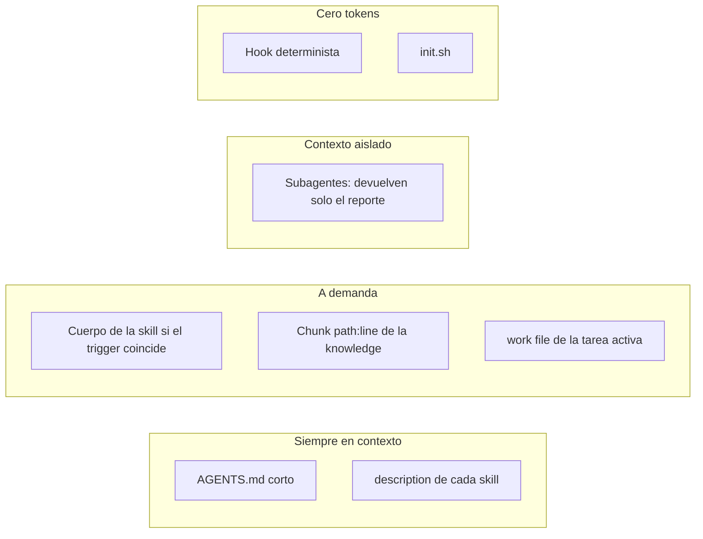

# Context engineering

## Qué es

Decidir **qué información entra en la ventana de contexto del modelo, cuándo entra y cuándo sale**. La ventana es finita, y la calidad de la respuesta cae antes de llenarla: con mucho ruido, el modelo atiende peor a lo que importa.

La ventana de contexto se trata como un **presupuesto**. Cada token cargado tiene que pagar su lugar.

## Por qué existe

Tres efectos hacen que "más contexto" no sea "mejor contexto":

1. **Dilución.** Una instrucción importante rodeada de 30 archivos irrelevantes pesa menos.
2. **Coste y latencia.** Cada turno reenvía el contexto acumulado. Un archivo leído al principio se paga en todos los turnos siguientes.
3. **Contaminación.** Un intento fallido, un error de una herramienta o una hipótesis descartada siguen en la ventana e influyen en lo que viene después.

## Las tres bases de contexto

Términos que se confunden a menudo:

| Base | Qué contiene | Cambia | Aquí |
|---|---|---|---|
| **Context base** | Lo que el agente necesita saber para trabajar en este repo: reglas, comandos, convenciones | Poco | `AGENTS.md`, skills |
| **Knowledge base** | Hechos del dominio: qué significa cada entidad, de dónde sale cada dato | Cuando el dominio cambia | `docs/knowledge/` |
| **Memoria** | Estado de una tarea o de una decisión | Con cada tarea | `docs/work/`, `docs/decisions/` |

La context base dice *cómo trabajar*. La knowledge base dice *qué es verdad*. La memoria dice *dónde quedamos y por qué*.

## Cómo funciona aquí: cuatro zonas

- **Siempre:** lo mínimo para orientarse. Cada línea aquí se paga en cada turno de cada sesión.
- **A demanda:** se carga cuando la tarea lo pide, y solo el fragmento necesario.
- **Aislado:** un subagente lee 20 archivos en su propia ventana y devuelve 30 líneas. La sesión principal solo paga las 30 líneas.
- **Cero tokens:** lo que se puede verificar con código no se le pide al modelo.

La pregunta para cada pieza nueva es: ¿en qué zona va?

## Coste en contexto

Ver la tabla de [token-economy](token-economy.md).

## Límites

- El harness puede indicarle al agente que lea un fragmento, pero no obligarlo. Un modelo puede ignorar `path:line` y abrir el archivo entero.
- La compactación automática del editor resume la conversación, y el resumen puede perder detalles. Por eso el estado importante vive en disco y no en la conversación.

## Cómo adaptarlo

Al agregar algo al harness, ubícalo en la zona más barata que funcione: primero cero tokens (código), después aislado (subagente), después a demanda (skill o knowledge), y solo al final siempre (`AGENTS.md`).
