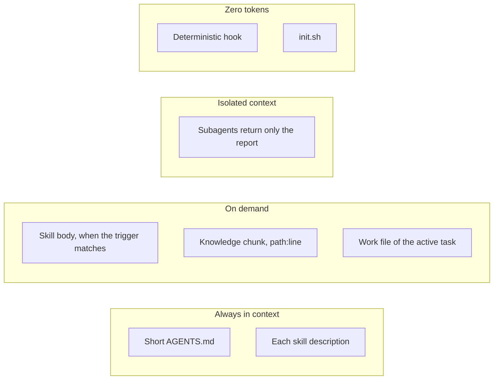

# Context engineering

**English** | [Español](context-engineering.es.md)

## What it is

Deciding **what information enters the model's context window, when it enters, and when it leaves**. The window is finite, and answer quality drops before it fills up: with enough noise, the model pays less attention to what matters.

Treat the context window as a **budget**. Every loaded token has to earn its place.

## Why it exists

Three effects make "more context" fail to mean "better context":

1. **Dilution.** An important instruction surrounded by 30 irrelevant files weighs less.
2. **Cost and latency.** Every turn resends the accumulated context. A file read at the start is paid for on every later turn.
3. **Contamination.** A failed attempt, a tool error, or a discarded hypothesis stays in the window and influences what comes next.

## The three context bases

Terms that get mixed up:

| Base | What it holds | It changes | Here |
|---|---|---|---|
| **Context base** | What the agent needs in order to work in this repo: rules, commands, conventions | Rarely | `AGENTS.md`, skills |
| **Knowledge base** | Domain facts: what each entity means, where each datum comes from | When the domain changes | `docs/knowledge/` |
| **Memory** | The state of a task or of a decision | With every task | `docs/work/`, `docs/decisions/` |

The context base says *how to work*. The knowledge base says *what is true*. Memory says *where we left off, and why*.

## How it works here: four zones

- **Always:** the minimum needed to get oriented. Every line here is paid on every turn of every session.
- **On demand:** loaded when the task needs it, and only the fragment that is needed.
- **Isolated:** a subagent reads 20 files in its own window and returns 30 lines. The main session pays only for those 30 lines.
- **Zero tokens:** what code can check is not asked of the model.

The question for every new piece is: which zone does it belong in?

## Cost in context

See the table in [token-economy](token-economy.md).

## Limits

- The harness can tell the agent to read a fragment. It cannot force it. A model can ignore `path:line` and open the whole file.
- The editor's automatic compaction summarizes the conversation, and the summary can drop detail. Important state lives on disk, not in the conversation.

## How to adapt it

When you add something to the harness, put it in the cheapest zone that still works: zero tokens (code) first, then isolated (a subagent), then on demand (a skill or knowledge), and only at the end always (`AGENTS.md`).
