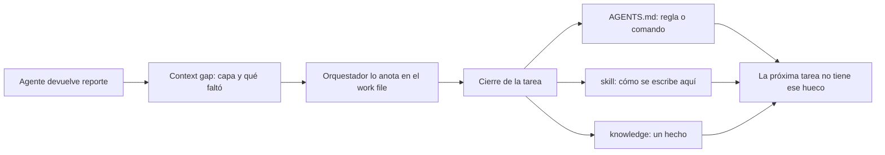

# Ciclo de retroalimentación: context gap

## Qué es

Cada reporte de agente termina con una sección **Context gap**: qué le faltó para cumplir y en cuál de las tres capas debería estar.

```markdown
## Context gap
- knowledge: no hay doc para la entidad "refund"; inferí el estado desde el código.
- skill: la skill de endpoints no dice dónde va la validación de input.
```

Al cerrar la tarea, el orquestador aplica cada gap a su capa. Es el mecanismo con el que el harness mejora con el uso.

## Por qué existe

Sin este ciclo, el mismo hueco se paga en cada tarea: cada sesión vuelve a leer el código para inferir lo mismo, o vuelve a equivocarse en lo mismo. Con el ciclo, el hueco se paga una vez.

Es la diferencia entre un agente que **se corrige** (en la conversación, y se pierde) y un harness que **aprende** (en disco, y se queda).

## Cómo funciona aquí



### A qué capa va cada gap

| El agente no sabía... | Capa |
|---|---|
| qué comando corre los tests, qué requiere permiso | `AGENTS.md` |
| cómo se estructura o se prueba este tipo de código | skill |
| qué significa un dato, de dónde sale, qué regla aplica | `docs/knowledge/` |

Nunca va al agente. Si un gap pide editar un agente, es una señal de que el agente se está acoplando al proyecto.

## Coste en contexto

Unas pocas líneas por reporte. El ahorro aparece en las tareas siguientes.

## Límites

- El agente puede reportar un gap falso para justificar un error. El orquestador lo filtra.
- Aplicar gaps sin criterio infla `AGENTS.md`. Ante la duda, a la capa a demanda (skill o knowledge), no a la siempre cargada.

## Cómo adaptarlo

Nada que adaptar: las tres capas son las mismas en cualquier proyecto.
