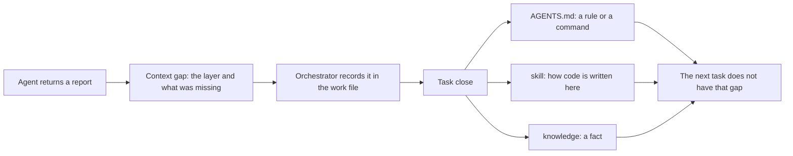

# Feedback loop: the context gap

**English** | [Español](feedback-loop.es.md)

## What it is

Every agent report ends with a **Context gap** section: what the agent lacked in order to comply, and which of the three layers should hold it.

```markdown
## Context gap
- knowledge: there is no doc for the "refund" entity; I inferred the state from the code.
- skill: the endpoint skill does not say where input validation goes.
```

When the task closes, the orchestrator applies each gap to its layer. That is how the harness improves with use.

## Why it exists

Without this loop, the same gap is paid on every task: every session rereads the code to infer the same fact, or makes the same mistake again. With the loop, the gap is paid once.

An agent **corrects itself** in the conversation, and the correction is lost. A harness **learns** on disk, and the correction stays.

## How it works here



### Which layer a gap belongs to

| The agent did not know... | Layer |
|---|---|
| which command runs the tests, what needs permission | `AGENTS.md` |
| how this kind of code is structured or tested | skill |
| what a datum means, where it comes from, which rule applies | `docs/knowledge/` |

It never belongs in an agent. A gap that asks to edit an agent is a sign the agent is coupling itself to the project.

## Cost in context

A few lines per report. The saving shows up on the tasks that follow.

## Limits

- An agent can report a false gap to justify a mistake. The orchestrator filters those.
- Applying gaps without judgment inflates `AGENTS.md`. When in doubt, use the on-demand layer (a skill or knowledge), not the always-loaded one.

## How to adapt it

Nothing to adapt. The three layers are the same in every project.
