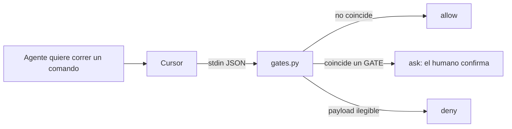

# Hooks

## Qué es

Un **hook** es un script que la herramienta ejecuta antes o después de un evento del agente. Aquí se usa `beforeShellExecution`: antes de correr cualquier comando de shell, Cursor le pasa el comando a `.cursor/hooks/gates.py` por stdin y espera una respuesta: `allow`, `ask` o `deny`.

## Por qué existe

Una regla escrita en `AGENTS.md` ("no hagas push sin permiso") es una sugerencia: el modelo la lee, ocupa tokens y puede olvidarla o reinterpretarla. Un hook es código:

| | Regla en el prompt | Hook |
|---|---|---|
| Se cumple | Casi siempre | Siempre |
| Coste en tokens | En cada turno | Cero |
| Se puede testear | No | Sí (`tests/test_gates.py`) |
| Ve | Todo lo que el modelo entiende | Solo el texto del comando |

Lo que se puede verificar con código no se le pide al modelo.

## Cómo funciona aquí

- `gates.py` recorre la tupla `GATES` (regex, nombre). La primera que coincide devuelve `ask`.
- **Fail-closed:** si stdin no es JSON, no es un objeto o el comando no es texto, responde `deny`. Y `hooks.json` declara `"failClosed": true`: si el script se cae, el comando no corre.
- Los gates por defecto son genéricos: commit, push, borrar, cambiar dependencias, deploy, infraestructura, y editar `.cursor/hooks/` (el agente no puede desactivar sus propios frenos sin permiso).

## Coste en contexto

Cero. El hook corre fuera del modelo. Solo cuando responde `ask` aparece un mensaje corto.

## Límites

- **Solo ve texto de shell.** No ve una edición de archivo, una escritura hecha dentro de un proceso en ejecución ni un borrado hecho desde código. Esos gates siguen dependiendo de `AGENTS.md`.
- **Regex sobre texto.** Un comando ofuscado (`r''m`, variables, `eval`) puede escapar. Es un freno para errores honestos, no una frontera de seguridad contra un adversario.
- **Falsos positivos.** `\bdeploy\b` también coincide con `rg deploy`. Es intencional: preguntar de más es barato, no preguntar es caro.
- **Workspace anidado.** Cursor carga el `hooks.json` del workspace abierto. Si abres una carpeta padre, el `hooks.json` de un repo anidado no se carga.

## Extensiones

- `beforeReadFile`: denegar la lectura de `.env` y credenciales por código, en vez de confiar en la instrucción del prompt.
- `afterFileEdit`: correr un formateador o un lint rápido después de cada edición.

Cada extensión es un script más con su test. Agrégalas cuando una regla de `AGENTS.md` se incumpla en la práctica.

## Cómo adaptarlo

Edita solo la tupla `GATES` en `gates.py` para reflejar la sección "Human gates" de tu `AGENTS.md`. Agrega un caso a `tests/test_gates.py` por cada gate nuevo.
