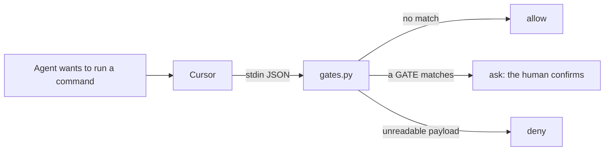

# Hooks

**English** | [Español](hooks.es.md)

## What it is

A **hook** is a script the tool runs before or after an agent event. This repo uses `beforeShellExecution`: before any shell command runs, Cursor passes the command to `.cursor/hooks/gates.py` on stdin and waits for `allow`, `ask`, or `deny`.

## Why it exists

A rule written in `AGENTS.md` ("do not push without permission") is a suggestion. The model reads it, it costs tokens, and the model can forget it or reinterpret it. A hook is code:

| | Rule in the prompt | Hook |
|---|---|---|
| It holds | Almost always | Always |
| Token cost | Every turn | Zero |
| Testable | No | Yes (`tests/test_gates.py`) |
| It sees | Whatever the model understands | Only the command text |

What code can check is not asked of the model.

## How it works here

- `gates.py` walks the `GATES` tuple of `(regex, name)`. The first match returns `ask`.
- **Fail-closed:** when stdin is not JSON, is not an object, or the command is not text, it answers `deny`. And `hooks.json` sets `"failClosed": true`, so a crashed script blocks the command.
- The default gates are generic: commit, push, delete, change dependencies, deploy, infrastructure, and editing `.cursor/hooks/` (the agent cannot disable its own brakes without permission).

## Cost in context

Zero. The hook runs outside the model. A short message appears only when it answers `ask`.

## Limits

- **It only sees shell text.** It does not see a file edit, a write done inside a running process, or a delete done from code. Those gates still depend on `AGENTS.md`.
- **Regex over text.** An obfuscated command (`r''m`, variables, `eval`) can slip through. It is a brake for honest mistakes, not a security boundary against an adversary.
- **False positives.** `\bdeploy\b` also matches `rg deploy`. That is intentional: asking once too often is cheap, and not asking is expensive.
- **Nested workspace.** Cursor loads the `hooks.json` of the workspace you opened. Opening a parent folder does not load a nested repo's `hooks.json`.

## Extensions

- `beforeReadFile`: deny reading `.env` and credentials in code, instead of trusting the prompt.
- `afterFileEdit`: run a formatter or a fast lint after each edit.

Each extension is one more script with its own test. Add one when a rule in `AGENTS.md` gets broken in practice.

## How to adapt it

Edit only the `GATES` tuple in `gates.py`, so it matches the "Human gates" section of your `AGENTS.md`. Add one case to `tests/test_gates.py` for each new gate.
