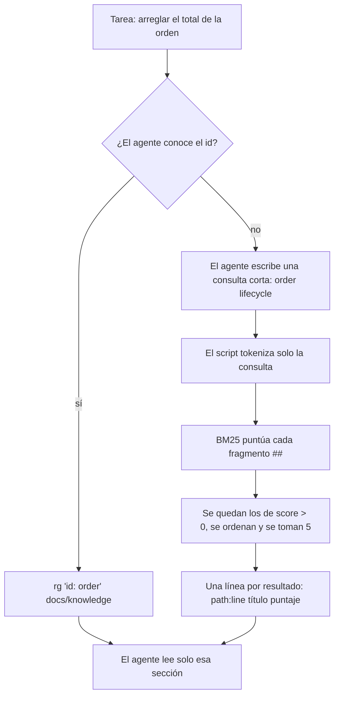

# Knowledge base

[English](knowledge-base.md) | **Español**

## Qué es

Una carpeta de markdown (`docs/knowledge/`) con los **hechos del dominio**: qué es cada entidad, de dónde sale cada dato, qué reglas de negocio aplican. Un archivo por entidad, con frontmatter plano para lo que se busca por clave.

No es documentación de código. El código dice *cómo*; la knowledge dice *qué es verdad* y *de dónde lo sabemos*.

## Por qué existe

- El modelo no conoce tu dominio. Sin una fuente escrita, lo infiere del código y adivina.
- Un hecho que solo vive en la conversación se pierde al cambiar de sesión.
- Un hecho sin fuente no se puede verificar. La regla es que **todo hecho lleva su fuente** (URL, `path:line`, comando) o dice "a verificar".

## Cómo funciona aquí

### Formato

```
docs/knowledge/<coleccion>/<entidad>.md
```

```markdown
---
id: order
status: active
verified: 2026-11-19
---
# Order
## Qué es
## Fuente
## Reglas
```

`id`, `status` y `verified` son obligatorios. El proyecto agrega las claves que necesite. Formato completo en [knowledge/README](../knowledge/README.es.md).

### Búsqueda en dos pasos

1. **Exacta:** con un identificador conocido, se busca el texto (`rg "id: order" docs/knowledge`). Cero ambigüedad.
2. **Por relevancia:** sin nombre exacto, `python3 -m scripts.knowledge_index search "<consulta>"`.

La segunda devuelve una línea por resultado, no archivos. Salida real para `order lifecycle`:

```
docs/knowledge/entities/order.md:14 Lifecycle 3.3722
```

El agente lee solo esa sección. Un archivo de 200 líneas se convierte en una lectura de 15.

### BM25 en memoria

`knowledge_index.py` divide cada archivo en fragmentos, uno por `## `, y los ordena con BM25: un ranking clásico de recuperación de información que puntúa según la frecuencia del término en el fragmento y su rareza en el corpus, y normaliza por longitud.

El índice se construye en cada llamada y no se guarda. Para unos cientos de archivos tarda milisegundos.

### El flujo de búsqueda, paso a paso



1. **El script nunca ve la tarea ni el chat.** El agente elige las palabras de la consulta. Lo hace el planner en el paso 2 de su prompt (`.cursor/agents/planner.md`).
2. **Tokenizar.** Pasa a minúsculas. Una palabra es una secuencia de letras y dígitos, así que la puntuación separa palabras. No hay lista de palabras vacías: "the" o "de" cuentan cuando aparecen, pero una palabra que está en muchos fragmentos pesa menos (IDF).
3. **Fragmentos.** Cada sección `## ` conserva su propio texto más los valores del frontmatter de su archivo. Así, `order` de `id: order` también cuenta en cada sección de `order.md`.
4. **Puntuar.** Para cada fragmento, se suma el puntaje de cada palabra de la consulta que contiene. Se descartan los ceros, se ordena por puntaje (empates por ruta y luego por línea) y se quedan 5.
5. **Salida.** Una línea por resultado. El agente lee desde esa línea hasta el siguiente `## `.

### Qué significa el puntaje

El puntaje es BM25 para una consulta. No es un porcentaje y no tiene escala fija. Una palabra suma más cuando aparece más veces en el fragmento (con rendimientos decrecientes), cuando es rara en el corpus y cuando el fragmento es más corto que el promedio. Compara puntajes solo dentro de la misma búsqueda.

| Campo | Significado |
|---|---|
| `path` | Archivo, relativo a la raíz del repo |
| `line` | Línea del encabezado `## `, desde 1 |
| `heading` | Texto del encabezado |
| `score` | BM25 para esta consulta, redondeado a 4 decimales |

Medido en la knowledge de este repo, con `search`:

| Consulta | Primer resultado | Puntaje | Qué muestra |
|---|---|---|---|
| `order lifecycle` | `entities/order.md:14 Lifecycle` | 3.3722 | Las dos palabras en la misma sección: el puntaje más alto |
| `order` | `README.md:19 File format` | 1.2691 | La sección de formato repite `id: order`; la entidad no entra en el top 5 |
| `pedido` | `entities/order.md:27 Notes` | 3.0009 | El nombre en español aparece solo en esa sección |
| `client` | sin resultados | — | No hay sinónimos |
| `xyzzy` | sin resultados | — | Nada coincide; imprime `no hits` y sale con código 0 |

### Por qué no embeddings

| | BM25 en memoria | Embeddings + base vectorial |
|---|---|---|
| Dependencias | Ninguna, stdlib | Modelo de embeddings, DB, cliente |
| Determinista | Sí, mismo input, mismo orden | Depende del modelo y su versión |
| Índice que regenerar | No | Sí, y puede quedar desfasado |
| Sinónimos | No | Sí |
| Testeable | Trivial | Difícil |

Para un corpus pequeño y técnico, donde las consultas usan los mismos términos que los docs, BM25 alcanza. Si el corpus crece a miles de documentos o las consultas son conceptuales, conviene reconsiderarlo con un ADR.

## Coste en contexto

Un resultado cuesta unos 15 tokens. Leer el fragmento cuesta lo que mida la sección. La alternativa, abrir archivos hasta encontrar el dato, cuesta varios archivos completos.

## Límites

- No entiende sinónimos: "cliente" no encuentra "customer". Mitigación: poner los dos términos en el doc.
- Un `## ` muy largo es un fragmento muy largo. Mantén secciones cortas.
- El frontmatter es plano (`clave: valor`). No admite listas ni anidamiento.

## Cómo adaptarlo

Elige las colecciones de tu dominio (`entities/`, `sources/`, `rules/`, ...) y las claves extra del frontmatter. El buscador no cambia.
