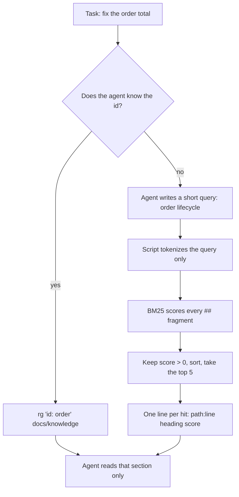

# Knowledge base

**English** | [Español](knowledge-base.es.md)

## What it is

A markdown folder (`docs/knowledge/`) of **domain facts**: what each entity is, where each datum comes from, which business rules apply. One file per entity, with flat frontmatter for anything looked up by key.

It is not code documentation. Code says *how*. Knowledge says *what is true* and *how we know*.

## Why it exists

- The model does not know your domain. Without a written source it infers the fact from the code and guesses.
- A fact that lives only in the conversation is lost when the session changes.
- A fact without a source cannot be checked. The rule is that **every fact carries its source** (a URL, a `path:line`, or a command) or says "unverified".

## How it works here

### Format

```
docs/knowledge/<collection>/<entity>.md
```

```markdown
---
id: order
status: active
verified: 2026-11-19
---
# Order
## What it is
## Source
## Rules
```

`id`, `status`, and `verified` are required. The project adds whatever keys it needs. Full format in [knowledge/README](../knowledge/README.md).

### Search in two steps

1. **Exact:** with a known identifier, search the text (`rg "id: order" docs/knowledge`). No ambiguity.
2. **By relevance:** without an exact name, `python3 -m scripts.knowledge_index search "<query>"`.

The second returns one line per hit, not files. Real output for `order lifecycle`:

```
docs/knowledge/entities/order.md:14 Lifecycle 3.3722
```

The agent reads only that section. A 200-line file becomes a 15-line read.

### BM25 in memory

`knowledge_index.py` splits each file into fragments, one per `## `, and ranks them with BM25: a classic information-retrieval score based on how often the term appears in the fragment, how rare it is in the corpus, and the fragment's length.

The index is built on every call and is not saved. A few hundred files take milliseconds.

### The search flow, step by step



1. **The script never sees the task or the chat.** The agent chooses the query words. The planner does it in step 2 of its prompt (`.cursor/agents/planner.md`).
2. **Tokenizing.** Lowercase. A word is a run of letters and digits, so punctuation splits words. There is no stopword list: "the" or "de" count when they appear, but a word found in many fragments weighs less (IDF).
3. **Fragments.** Each `## ` section keeps its own text plus the frontmatter values of its file. So `order` from `id: order` also counts in every section of `order.md`.
4. **Scoring.** For each fragment, add the score of every query word it contains. Drop zeros, sort by score (ties by path, then line), keep 5.
5. **Output.** One line per hit. The agent reads from that line to the next `## `.

### What the score means

The score is BM25 for one query. It is not a percentage and it has no fixed scale. A word adds more when it appears more often in the fragment (with diminishing returns), when it is rare across the corpus, and when the fragment is shorter than average. Compare scores only inside the same search.

| Field | Meaning |
|---|---|
| `path` | File, relative to the repo root |
| `line` | Line of the `## ` heading, 1-based |
| `heading` | Heading text |
| `score` | BM25 for this query, rounded to 4 decimals |

Measured on this repo's knowledge, with `search`:

| Query | Top hit | Score | What it shows |
|---|---|---|---|
| `order lifecycle` | `entities/order.md:14 Lifecycle` | 3.3722 | Both words in the same section: the highest score |
| `order` | `README.md:19 File format` | 1.2691 | The format section repeats `id: order`; the entity is not in the top 5 |
| `pedido` | `entities/order.md:27 Notes` | 3.0009 | The Spanish name appears only in that section |
| `client` | no hits | — | No synonyms |
| `xyzzy` | no hits | — | Nothing matches; the script prints `no hits` and exits 0 |

### Why not embeddings

| | In-memory BM25 | Embeddings plus a vector database |
|---|---|---|
| Dependencies | None, stdlib | An embedding model, a database, a client |
| Deterministic | Yes: same input, same order | Depends on the model and its version |
| An index to regenerate | No | Yes, and it can drift from the docs |
| Synonyms | No | Yes |
| Testable | Trivial | Hard |

For a small technical corpus, where queries use the same words as the docs, BM25 is enough. If the corpus grows to thousands of documents, or queries stop using the docs' own words, reconsider it with an ADR.

## Cost in context

One hit costs about 15 tokens. Reading the fragment costs whatever the section measures. The alternative, opening files until the fact turns up, costs several whole files.

## Limits

- It does not understand synonyms: "client" does not find "customer". Mitigation: write both words in the doc.
- A very long `## ` is a very long fragment. Keep sections short.
- Frontmatter is flat (`key: value`). It does not allow lists or nesting.

## How to adapt it

Choose the collections for your domain (`entities/`, `sources/`, `rules/`, ...) and the extra frontmatter keys. The search script does not change.
