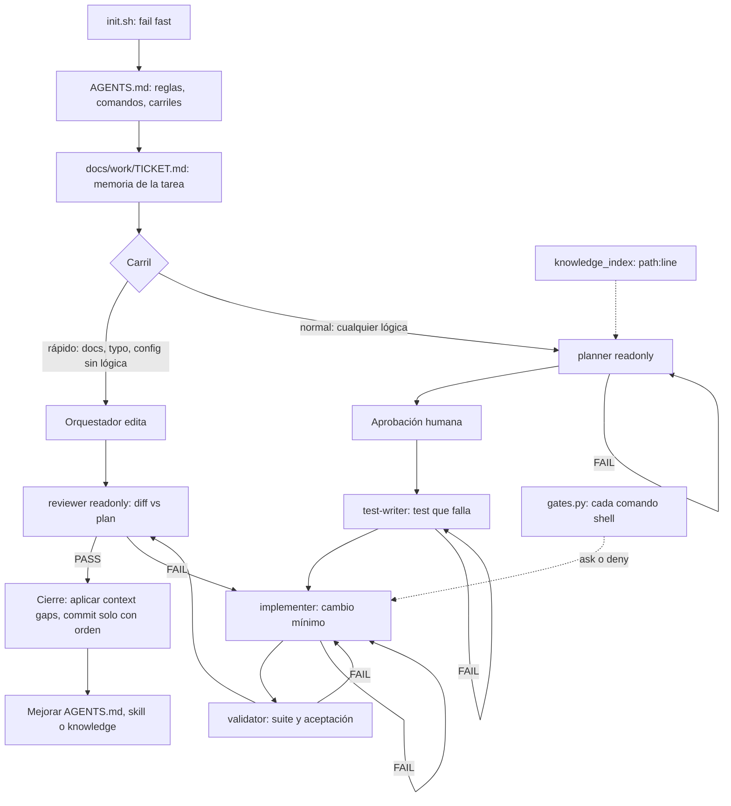

# Pipeline y carriles

[English](pipeline-and-lanes.md) | **Español**

## Qué es

El orden fijo en que una tarea pasa por los agentes, con dos carriles según el riesgo del cambio.

## Por qué existe

- **Orden fijo:** el agente no decide sobre la marcha si hace falta un test o una revisión. Lo decide la estructura.
- **Aprobación humana en un solo punto:** el humano aprueba el plan, no cada edición. Es el punto más barato para corregir el rumbo: todavía no hay código.
- **Dos carriles:** pasar un typo por cinco etapas gasta tokens sin reducir riesgo. Saltarse etapas en un cambio de lógica ahorra tokens y agrega riesgo.

## Cómo funciona aquí

### Carriles

| Carril | Cuándo | Etapas |
|---|---|---|
| Rápido | Docs, typos, comentarios, config sin lógica | orquestador -> reviewer |
| Normal | Cualquier cambio de lógica, comportamiento o interfaz | las seis etapas |

Ante la duda, carril normal. El reviewer corre en los dos carriles porque es la etapa más barata que atrapa secretos y restos de debug.

### A dónde vuelve cada FAIL

| Falla | Vuelve a | Por qué |
|---|---|---|
| planner | planner | Le faltó información: se completa y se replanifica |
| test-writer | test-writer | El test no falla por la razón correcta |
| implementer | implementer | El test no pasa todavía |
| validator | implementer | La suite o la aceptación muestran que el código está mal |
| reviewer | implementer | El diff no cumple el plan |

Si el implementer concluye que el problema está en el plan o en el test, devuelve `FAIL` y lo dice; el orquestador decide si vuelve al planner.

### Paso a paso de una tarea normal

1. `./scripts/init.sh`. Si falla, no se avanza.
2. El orquestador crea `docs/work/<TICKET>.md` desde la plantilla.
3. **planner** devuelve el plan. El orquestador lo copia al work file.
4. **Humano** aprueba o corrige.
5. **test-writer** deja un test rojo.
6. **implementer** lo pone en verde.
7. **validator** corre todo y la aceptación del work file.
8. **reviewer** revisa el diff.
9. Cierre: context gaps aplicados, decisión registrada si la hubo, resumen al PR, work file borrado. Commit solo con orden explícita.

## Coste en contexto

El carril normal cuesta más tokens en total que un solo agente haciendo todo, pero menos en la sesión principal, y produce menos retrabajo. El carril rápido cuesta casi lo mismo que editar directo, más una revisión.

## Límites

- El pipeline no impide que el humano apruebe un mal plan.
- La clasificación de carril la hace el orquestador; puede equivocarse. Por eso la regla es "ante la duda, normal".

## Cómo adaptarlo

Ajusta la definición de cada carril en `AGENTS.md`, sección Lanes. El orden de las etapas no cambia.
