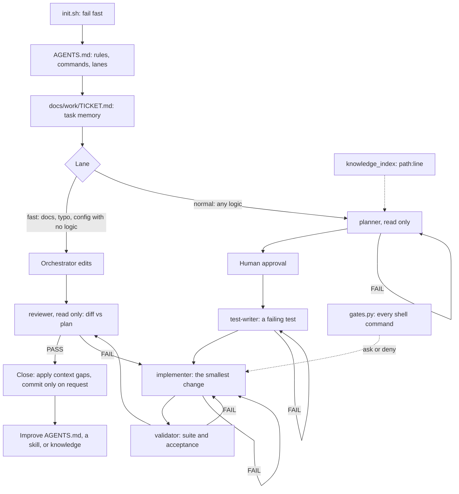

# Pipeline and lanes

**English** | [Español](pipeline-and-lanes.es.md)

## What it is

The fixed order in which a task passes through the agents, with two lanes according to the risk of the change.

## Why it exists

- **Fixed order:** the agent does not decide on the fly whether a test or a review is needed. The structure decides.
- **One human approval point:** the human approves the plan, not every edit. It is the cheapest moment to correct course: there is no code yet.
- **Two lanes:** sending a typo through five stages spends tokens without reducing risk. Skipping stages on a logic change saves tokens and adds risk.

## How it works here

### Lanes

| Lane | When | Stages |
|---|---|---|
| Fast | Docs, typos, comments, config with no logic | orchestrator, then reviewer |
| Normal | Any change to logic, behavior, or an interface | all six stages |

When in doubt, normal lane. The reviewer runs on both lanes because it is the cheapest stage that catches secrets and debug leftovers.

### Where each FAIL returns

| Failure | Returns to | Why |
|---|---|---|
| planner | planner | Information was missing: complete it and replan |
| test-writer | test-writer | The test does not fail for the right reason |
| implementer | implementer | The test does not pass yet |
| validator | implementer | The suite or the acceptance check shows the code is wrong |
| reviewer | implementer | The diff does not match the plan |

When the implementer concludes the problem is in the plan or the test, it returns `FAIL` and says so. The orchestrator decides whether to go back to the planner.

### A normal task, step by step

1. `./scripts/init.sh`. A failure stops the session.
2. The orchestrator creates `docs/work/<TICKET>.md` from the template.
3. **planner** returns the plan. The orchestrator copies it into the work file.
4. The **human** approves or corrects it.
5. **test-writer** leaves a red test.
6. **implementer** turns it green.
7. **validator** runs the suite and the acceptance check in the work file.
8. **reviewer** reviews the diff.
9. Close: context gaps applied, a decision recorded when one was made, the summary in the PR, the work file deleted. Commit only on an explicit order.

## Cost in context

The normal lane costs more tokens in total than one agent doing everything, and less in the main session, and it produces less rework. The fast lane costs about as much as editing directly, plus a review.

## Limits

- The pipeline does not stop a human from approving a bad plan.
- The orchestrator classifies the lane, and it can be wrong. That is why the rule is "when in doubt, normal".

## How to adapt it

Adjust the definition of each lane in `AGENTS.md`, section Lanes. The order of the stages does not change.
